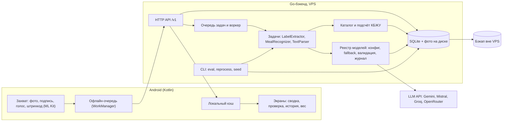
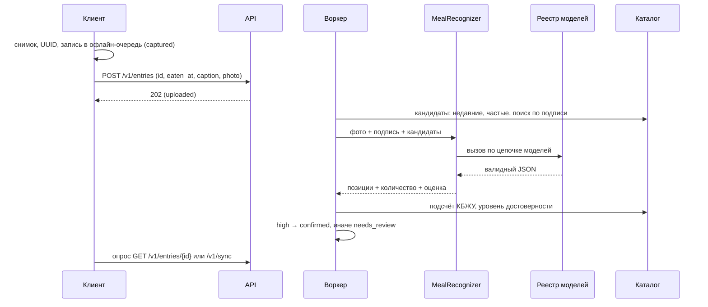
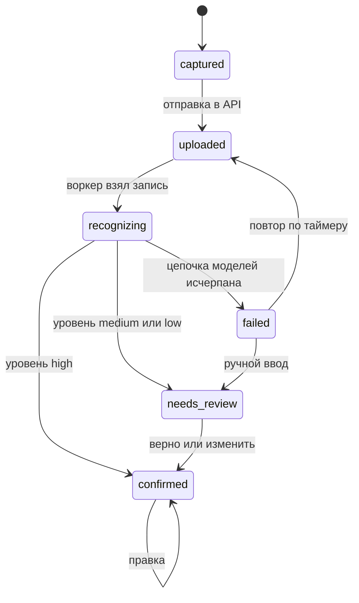

# Foody: архитектура

Требования, решения (D-xx) и модель данных: [requirements.md](requirements.md). План работ: [plan.md](plan.md).

## 1. Принципы

1. **LLM не считает КБЖУ.** Модель опознаёт позиции и оценивает количество, КБЖУ считает код по каталогу (D-04).
2. **Распознавание = сопоставление с каталогом.** Модели передаётся список кандидатов; новая позиция создаётся, только если совпадения нет.
3. **Толстый сервер, тонкий клиент.** Вся логика в Go; клиент снимает, ставит в очередь, показывает (D-07).
4. **Задачи, а не LLM.** Код зависит от интерфейсов задач; модели, цепочки и промпты задаются конфигом (D-05, NFR-07).
5. **Асинхронность и идемпотентность.** Приём записи мгновенный (202), обработка в фоне; UUID записи генерирует клиент (NFR-02, NFR-05).
6. **Ничего не теряем.** Фото, сырые ответы моделей, правки и итоги хранятся всегда (FR-17).

## 2. Компоненты



| Компонент | Ответственность | Не делает |
|---|---|---|
| Захват (клиент) | камера, подпись, голос → текст (Android), штрихкод на устройстве, сжатие фото до 1024 px | не распознаёт еду |
| Офлайн-очередь (клиент) | хранит записи до отправки, повторяет отправку | не меняет данные |
| Экраны (клиент) | сводка дня, проверка 🟡/🔴, правка, история, вес | не считает КБЖУ |
| HTTP API | аутентификация, приём записей (202), чтение, правки, синхронизация | не вызывает модели синхронно |
| Воркер | берёт записи в статусе `uploaded`, запускает конвейер, двигает состояния | не содержит логики задач |
| Задачи | превращают вход (фото, текст) в структурированный результат | не считают КБЖУ, не знают о провайдерах |
| Реестр моделей | выбор модели по задаче, fallback, валидация JSON, журнал вызовов | не знает о предметной области |
| Каталог | поиск позиций, кандидаты для опознания, проверки этикеток, подсчёт КБЖУ | не обращается к LLM |
| Хранилище | SQLite (WAL), фото на диске | — |
| CLI | eval на золотом наборе, пересчёт истории, загрузка сида | — |

## 3. Основные потоки

### 3.1. Фото или текст еды



Без фото (только подпись) поток тот же; задача получает текст вместо изображения.

### 3.2. Штрихкод

1. Клиент считывает код на устройстве (ML Kit) и запрашивает `GET /v1/catalog/barcode/{code}`.
2. Найден → запись создаётся сразу со ссылкой на позицию, уровень `high`, без LLM.
3. Не найден → клиент предлагает сфотографировать этикетку (поток 3.3), код сохраняется в новой позиции.

### 3.3. Этикетка

1. `POST /v1/catalog/labels` (фото, необязательный штрихкод) → 202.
2. `LabelExtractor` (промпт `label_v2`) находит пищевую ценность в таблице или в строке посреди текста и переписывает её как напечатано: цитату фрагмента, порцию («на 100 г», «на порцию 30 г»), ккал и кДж, БЖУ, упаковку в её единицах, пометки «не более» и сомнения. Пересчёт на 100 г или 100 мл, кДж → ккал и кг/л → г/мл делает код (ADR 007).
3. Проверки (FR-05, ADR 001), одинаковые для обеих баз:
   - `|ккал − (4·Б + 9·Ж + 4·У)| ≤ max(0.15 · ккал, 5)`;
   - `Б + Ж + У ≤ 100` на 100 г (мл);
   - `ккал ≤ 900` на 100 г (мл), все значения ≥ 0.
4. Если в конфиге `cross_check: true` — модели цепочки вызываются по очереди, пока две не дадут ответ: первая даёт основное извлечение, вторая — независимую сверку. Расхождение базы, размера упаковки или любого числа больше max(2%, 0.1) → на подтверждение. Ответила только одна модель → тоже на подтверждение (`cross_check_unavailable`).
   Модель может ответить `{"unreadable": "..."}`, если таблицы КБЖУ на фото нет; тогда этикетка не создаётся.
5. Прошло проверки и сверку → позиция создаётся с `verified = false` и показывается пользователю один раз; после подтверждения `verified = true`.

## 4. Конвейер распознавания

### 4.1. Кандидаты из каталога

Перед вызовом модели каталог собирает до ~20 кандидатов:
- позиции, совпавшие с подписью (поиск по названию и `aliases`);
- последние и самые частые позиции пользователя;
- позиции сетей, если подпись упоминает сеть.

Модель выбирает из кандидатов или возвращает новую позицию.

### 4.2. Контракт ответа MealRecognizer

```json
{
  "items": [
    {
      "catalog_item_id": "uuid или null",
      "new_item": {
        "name": "Пицца пепперони, кусок",
        "kind": "estimated_dish",
        "basis": "g",
        "per_100": {"kcal": 270, "protein": 11, "fat": 12, "carbs": 30}
      },
      "quantity": 3,
      "unit": "piece",
      "amount_estimate": 330,
      "quantity_source": "caption"
    }
  ],
  "notes": "строка для отладки, необязательно"
}
```

Правила:
- ровно одно из `catalog_item_id` и `new_item`;
- `quantity_source`: `caption` (указано пользователем), `standard` (стандартная порция позиции), `estimate` (оценено по фото);
- `basis`: `g` или `ml`; `per_100` и `amount_estimate` — в единицах базы (ADR 001);
- `per_100` у новой позиции — оценка модели, её источник помечается `llm_estimate`.

### 4.3. Уровень достоверности

Уровень строки:

| Условие | Уровень |
|---|---|
| позиция из каталога с источником `label` или `official_menu`, количество `caption` или `standard` | `high` |
| позиция из каталога, количество `estimate` | `medium` |
| новая позиция (`llm_estimate`) | `low` |

Уровень записи = минимальный уровень её строк. `high` → `confirmed` автоматически (с отменой), иначе `needs_review` (FR-11).

## 5. Слой моделей

### 5.1. Интерфейсы задач

```go
type MealRecognizer interface {
    Recognize(ctx context.Context, in MealInput) (*MealResult, error)
}

type LabelExtractor interface {
    Extract(ctx context.Context, img Image) (*NutritionLabel, error)
}

type TextParser interface {
    Parse(ctx context.Context, text string, candidates []CatalogItem) (*MealResult, error)
}
```

Реализации задач получают зависимость от реестра моделей, а не от конкретного клиента.

### 5.2. Конфигурация

```yaml
providers:
  gemini:  { base_url: "https://generativelanguage.googleapis.com/v1beta/openai", api_key_env: GEMINI_API_KEY }
  mistral: { base_url: "https://api.mistral.ai/v1", api_key_env: MISTRAL_API_KEY }
  groq:    { base_url: "https://api.groq.com/openai/v1", api_key_env: GROQ_API_KEY }
  openrouter: { base_url: "https://openrouter.ai/api/v1", api_key_env: OPENROUTER_API_KEY }

tasks:
  label_extraction:
    prompt: ../prompts/label_v1.md   # путь от каталога конфига
    cross_check: true            # вторая модель для сверки
    chain:
      - { provider: gemini,  model: "<flash>", timeout: 30s, price: { input: 0, output: 0 } }
      - { provider: mistral, model: "<vision>", timeout: 30s }
  meal_recognition:             # включает неизвестные блюда (new_item), ADR 002
    prompt: ../prompts/meal_v1.md
    chain:
      - { provider: gemini, model: "<flash-lite>" }
      - { provider: groq,   model: "<llama-4-scout>" }
  text_parse:
    prompt: ../prompts/text_v1.md
    chain:
      - { provider: groq,   model: "<llama-4-scout>" }
      - { provider: gemini, model: "<flash-lite>" }
```

Base URL и имена моделей уточняются при реализации по документации провайдеров. `timeout` по умолчанию 30s; `price` — доллары за 1M токенов входа и выхода, по умолчанию 0. Неизвестные поля — ошибка. Версия конфигурации = хэш задачи (модели цепочки + версия и текст промпта), пишется в `recognition_runs.config_version`. Подробности — ADR 004.

### 5.3. Правила вызова

- Переход к следующей модели в цепочке: таймаут, HTTP 429, 5xx, сетевая ошибка, невалидный JSON или нарушение схемы.
- HTTP 4xx (кроме 429) — ошибка конфигурации: логируется, к следующей модели.
- Нет ключа API провайдера → статус `config_error`, к следующей модели без запроса; так eval работает с частью ключей.
- При 429 запрос уходит следующей модели сразу, паузу из `Retry-After` реестр не выдерживает.
- Отмена внешнего контекста (запись удалена, сервер останавливается) прерывает цепочку без перехода дальше.
- Ответ валидируется по схеме задачи (Go-тип + `Validate()`, ADR 006); при нарушении — один повтор той же модели с её ответом и текстом ошибки, затем следующая модель.
- Вся цепочка исчерпана → запись `failed`.
- Каждая попытка, включая неудачные, пишется в `model_calls`.

### 5.4. Eval

`foody eval --task meal_recognition --config config/models.yaml --set data/golden/cases.yaml`

На этапе 1 eval прогоняет `label_extraction` и `meal_recognition` (ADR 002).

- прогоняет набор через каждую модель цепочки по отдельности (не fallback);
- метрики: точность опознания top-1, ошибка ккал в %, полное совпадение полей этикетки, доля валидных ответов, задержка p50/p95, стоимость;
- результат: таблица в stdout и JSON-отчёт в `data/eval/`.

## 6. Жизненный цикл записи



| Из | В | Событие | Кто | Побочные эффекты |
|---|---|---|---|---|
| — | `captured` | снимок или ввод текста | клиент | запись в офлайн-очередь, UUID |
| `captured` | `uploaded` | `POST /v1/entries` успешен | API | фото на диск, строка в `meal_entries` |
| `uploaded` | `recognizing` | воркер взял запись | воркер | новый `recognition_runs` |
| `recognizing` | `confirmed` | все строки `high` | воркер | `entry_items` со снимком КБЖУ |
| `recognizing` | `needs_review` | есть `medium` или `low` | воркер | `entry_items` со снимком КБЖУ |
| `recognizing` | `failed` | цепочка исчерпана | воркер | ошибка в `recognition_runs` |
| `failed` | `uploaded` | повтор по таймеру (до 3 раз, пауза растёт) | воркер | — |
| `failed` | `needs_review` | пользователь ввёл вручную | API | строки из ручного ввода |
| `needs_review` | `confirmed` | «верно» или правка | API | `entry_edits` при правке |
| `confirmed` | `confirmed` | правка | API | `entry_edits`, пересчёт снимка |
| любое | удалена | удаление | API | `deleted_at`, отмена возможна |

Повторная отправка той же записи (тот же UUID) не создаёт дубль и не меняет состояние. Пересчёт другой конфигурацией (FR-18) создаёт новый `recognition_runs` с `is_active = false` и не меняет состояние записи.

## 7. Хранение

- БД: `data/foody.db`, SQLite в режиме WAL, миграции — встроенные SQL-файлы.
- Журнал вызовов моделей на этапе 1: `data/logs/model_calls.jsonl` (строка на попытку, поля как в `model_calls`, права 0600); на этапе 2 переносится в БД.
- Фото: `data/photos/YYYY/MM/<sha256>.jpg`; ссылка через `photos.path`, дубли по хэшу не сохраняются.
- Снимок КБЖУ в `entry_items` фиксируется при подтверждении; изменение каталога историю не меняет.
- Объём: около 200 КБ на фото, < 1 ГБ в год.

## 8. Развёртывание и эксплуатация

- Один бинарник `server` (API + воркер в одном процессе) под systemd.
- HTTPS: обратный прокси с автоматическими сертификатами (например, Caddy) или TLS в самом Go-сервере.
- Конфиг и ключи: `config/models.yaml` + переменные окружения из `.env`.
- Бэкап раз в сутки: `VACUUM INTO` в отдельный файл + фото → копия вне VPS.
- Ограничения VPS (1 ядро, 2 ГБ): воркер обрабатывает записи последовательно, без пула горутин на вызовы моделей.

## 9. Безопасность

- Только HTTPS.
- Аутентификация: `Authorization: Bearer <token>`; в БД хранится хэш токена, токен привязан к `users.id`.
- Все запросы к данным фильтруются по `user_id` из токена.
- Ключи API провайдеров только на сервере, в клиент не попадают.

## 10. Клиент (этап 3)

- Kotlin + Jetpack Compose, одна Activity.
- Room — локальный кэш записей и сводки; WorkManager — отправка очереди.
- ML Kit — штрихкоды на устройстве; распознавание речи — встроенное в Android.
- Сжатие фото до 1024 px по длинной стороне перед постановкой в очередь.
- Точки входа: иконка, плитка в шторке, виджет со сводкой дня.
- Обновление статусов: опрос с нарастающей паузой, пока экран открыт; push — после MVP.
